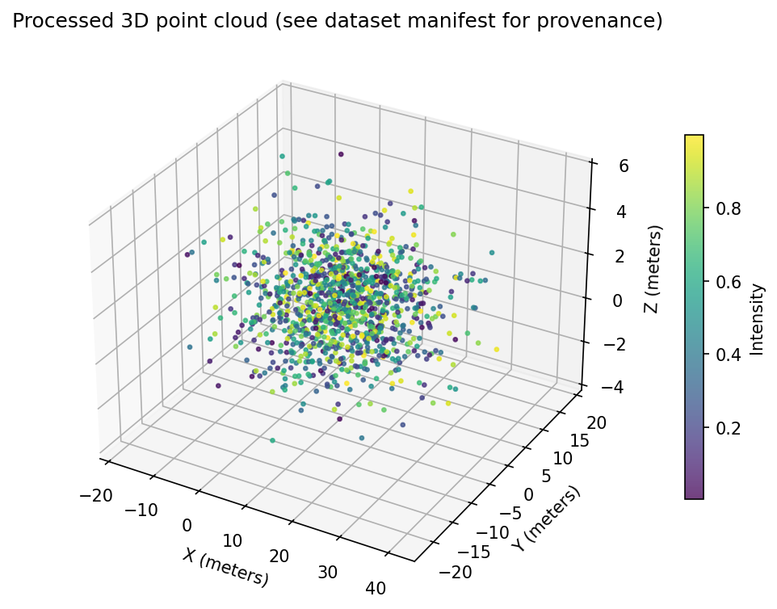

# LiDAR & Sensor Data Engineering Pipeline

A Python-based data engineering pipeline for processing 3D point cloud datasets, validating sensor measurements, and preparing structured data for downstream analytics and machine learning workflows.

## Overview

The pipeline supports structured CSV datasets and KITTI-style LiDAR binary files. It performs data cleaning, quality validation, frame-level analysis, dataset splitting, and metadata storage.

## Tech Stack

- Python
- NumPy & Pandas
- SQL (SQLite)
- Matplotlib
- Git & GitHub

## Key Features

- LiDAR point cloud data ingestion
- Missing and invalid value detection
- Intensity and distance validation
- Duplicate point removal
- Data quality reporting and KPIs
- Scene-based Train / Validation / Test splitting
- Dataset fingerprinting using SHA-256
- Metadata storage in SQLite
- 3D point cloud visualization
- Automated unit tests

## Pipeline Architecture

Raw Sensor Data
    |
    v
Data Ingestion
    |
    v
Data Cleaning & Validation
    |
    v
Duplicate Removal
    |
    v
Quality Metrics & Metadata
    |
    v
Dataset Splitting
    |
    v
Processed Data + SQLite + Visualization

## Sample Processing Results

The pipeline was tested using synthetic LiDAR-style point cloud data.

| Metric | Result |
|---|---|
| Raw Points | 1,202 |
| Clean Points | 1,196 |
| Removed Points | 6 |
| Retention Rate | 99.5% |
| Frames | 12 |
| Scenes | 6 |
| Train / Validation / Test Frames | 8 / 2 / 2 |

## Visualization



## Getting Started

Install dependencies:

```bash
pip install -r requirements.txt
```

Generate sample data:

```bash
python src/generate_sample.py
```

Run the data pipeline:

```bash
python src/pipeline.py
```

Generate the visualization:

```bash
python src/visualize.py
```

Run automated tests:

```bash
python -m unittest discover -s tests -v
```

## Project Structure

- `src/` - Data generation, processing, and visualization
- `tests/` - Automated tests
- `data/raw/` - Input datasets
- `data/processed/` - Generated outputs
- `docs/` - Sample reports and visualization

## Technical Notes

The included dataset is synthetic and intended for pipeline development and validation. The pipeline also supports compatible KITTI-style binary point clouds.

Dataset fingerprints provide change tracking but do not replace a dedicated dataset-versioning platform. The project focuses on data engineering and preparation rather than LiDAR calibration or model training.
